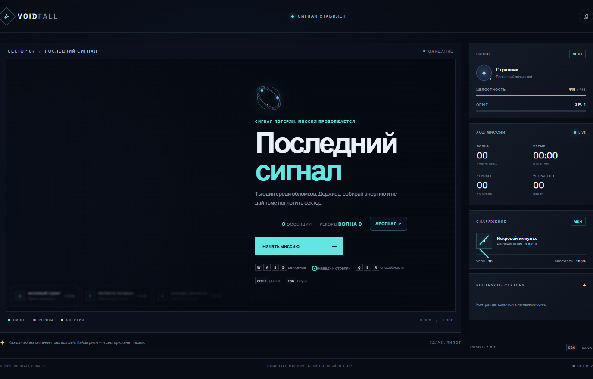

# GhosTnever — инструменты проверки игровых модов

Сайт-портфолио **GhosTnever** сосредоточен на ModRelease Studio и трёх связанных инструментах для проверки и выпуска игровых модов: ModRelease Gate, Paradox Mod Quality Gate и Paradox Mod Workbench. Остальные проекты и эксперименты доступны в сворачиваемом каталоге.

## Сайт

- Портфолио: <https://ghostnever-lkm.github.io/>
- GitHub: <https://github.com/GhosTnever-lkm>
- План разработки: <https://github.com/users/GhosTnever-lkm/projects/2/views/1>

## Обновление версии

Текущая версия указана в `VERSION`, история изменений — в `CHANGELOG.md`. GitHub Actions публикует содержимое ветки `main` в GitHub Pages.

Страница содержит canonical URL, метаданные на русском языке, ProfilePage/Person structured data, `robots.txt` и `sitemap.xml`. Pages workflow проверяет ключевые карточки, версии релизов и ссылки CI перед публикацией.

Сайт статический, не собирает данные посетителей и не требует серверной части.

## Превью VOIDFALL

Снимок сделан в опубликованной браузерной версии игры. Открыть игру: <https://ghostnever-lkm.github.io/voidfall/>.

Сайт распространяется по лицензии MIT. Условия для сторонних проектов и материалов указаны в их собственных репозиториях.
